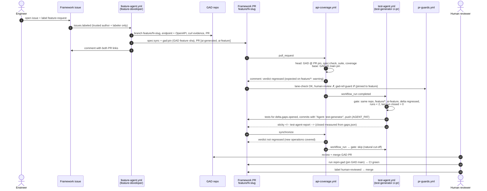

# Day 4: a multi-agent pipeline in GitHub Actions

**Concept: orchestration.** Two specialized agents, each with a narrow lane, are chained by CI. Neither agent judges its own work: the **coverage tool** decides whether behavior is tested, **`spec:check`** decides whether the contract matches GAD, and **`lane-check`** decides whether each agent stayed in its lane. Every loop is **bounded** (turns, time, attempts, runs per PR), and a human reviews and merges.

| Agent | Definition | Does | Never does |
|---|---|---|---|
| `feature-developer` | `.claude/agents/feature-developer.md` + `.claude/feature-developer.settings.json` | Implements a **new** GAD endpoint from an issue, documents it in GAD's OpenAPI, verifies it (curl, `spec:check`, full API suite), opens a GAD PR and a framework PR that syncs the spec and pins GAD | Write tests; edit framework files by hand; change existing GAD endpoints |
| `test-generator` (Day 3, new `ci-pr` mode) | `.claude/agents/test-generator.md` + `.claude/test-generator.settings.json`, launched with `/fill-coverage-gaps --mode ci-pr` | Writes tests for exactly the gaps the feature PR opened and pushes them to the same PR | Touch the spec, the tool, CI, exclusions; open PRs |

Cross-repo: GAD stays in `shunior-bo/gad-gui-api-demo`, the framework in `shunior-bo/api-framework-test`. The "same PR" the test agent pushes to is the **framework** PR.

---

## 1. Flow



---

## 2. Lanes

| Author (commit trailer `Agent:`) | Repository | Allowed paths |
|---|---|---|
| `feature-developer` | GAD | a new `endpoints/<resource>-endpoint.helpers.js`, the dispatch lines in `routes/validations.route.js`, `public/tools/schema/openapi_rest_demo.json`, and only if a flag is unavoidable `config/config-features.js` + `config/enums.js` (flag ON by default). Enforced by its settings file and instructions; **not** checked by `lane-check` (it runs in the framework). |
| `feature-developer` | framework | `spec/openapi.json`, `gad.ref.json`, changed **only** through `npm run spec:sync` and `npm run gad:pin` |
| `repin-gad` (workflow) | framework | `spec/openapi.json`, `gad.ref.json` |
| `test-generator` | framework | `src/api/**`, `src/models/**`, `src/utils/schema.ts`, `src/data/**`, `src/fixtures/api.fixture.ts`, `tests/api/**`, `tests/unit/schema.spec.ts`, `docs/ai-generation/**` |
| no trailer | framework | allowed (a human), listed in the lane-check summary. A commit from a **bot identity** without a trailer is a violation. |

`lane-check` also fails an agent commit that adds a coverage exclusion or `ignoreUnmatched` glob, removes or changes a non-import line in a test file that existed at the PR base, or adds `.only(` / `test.skip(` / `test.fixme(`. An added `test.fail(` is a warning (the reviewer checks its curl evidence).

**Limits of the lane check** (it reads diffs, not intent): the trailer is self-declared, so a commit could claim the wrong agent (a bot commit with **no** trailer is caught; a human commit is trusted). Additions inside an existing test (for example an early `return`) are not detected, because only removed lines are checked. The import heuristic accepts identifier-only lines, so a removed line that is a bare identifier passes. GAD-side lanes rely on the agent's permissions, its instructions and the GAD PR review.

---

## 3. Workflows

| Workflow | Trigger | Runs when | Secrets | Job permissions | Limits |
|---|---|---|---|---|---|
| `feature-agent.yml` | `issues: labeled` | label `feature-request`; labeler has write/maintain/admin **and** issue author is OWNER/MEMBER/COLLABORATOR; open issue, not a PR | `AGENT_PAT`, `ANTHROPIC_API_KEY` or `CLAUDE_CODE_OAUTH_TOKEN` | gate: `contents: read`; develop: `contents: read`, `issues: write` | `--max-turns 150`, 60 min, 3 verification attempts, concurrency per issue |
| `api-coverage.yml` | `pull_request`, `push` (main, session/**), dispatch | always | `AGENT_PAT` or `GAD_REPO_TOKEN` (optional while GAD is public) | coverage: `contents: read`; report: + `pull-requests: write`, `issues: write` | 20 + 10 min |
| `test-agent.yml` | `workflow_run` of "API coverage", `completed` | `pull_request` from this repo, `feature/*`, open PR with `ai-feature`, head = run sha, not `ai-tests-blocked`, `delta.json` verdict `regressed` or an uncovered added operation, run labels < 2, last run closed > 0 | `AGENT_PAT`, Anthropic secret | `contents: read`, `actions: read`, `pull-requests: write`, `issues: write` | `--max-turns 200`, 60 min, **2 runs per PR**, ≤ 3 batches × 5 gaps, 3 attempts per batch, concurrency per branch (no cancel) |
| `pr-guards.yml` | `pull_request` (opened, synchronize, reopened, labeled, unlabeled, ready_for_review) | lane-check: label `ai-generated`; human-review: always; gad-ref-guard: base is `main` | none | `contents: read` (+ `pull-requests: write` for human-review) | 5 min each |
| `repin-gad.yml` | `workflow_dispatch` (`pr_number`, `allow_spec_sync`) | open same-repo `feature/*` PR into main | `AGENT_PAT` | `contents: read`, `pull-requests: read` | 10 min |

`issues` and `workflow_run` workflows **only run from the default branch**: they start working once this PR is merged to `main`.

### Loop bound (test agent)

Runs are counted with the labels **`ai-tests-run-1` / `ai-tests-run-2`**, added by the gate **before** the agent starts (a crashed run still counts). Labels were chosen over counting `Agent: test-generator` commits because a run that pushes nothing must still count, and a human can grant one more run by removing a label. The logic is in `.github/scripts/test-agent.js` (unit tests: `tests/unit/ci/testAgent.spec.ts`):

1. Natural cut-off: once the verdict is not `regressed` and every added operation is covered, nothing runs, whoever pushed last (including the agent's own push).
2. `ai-tests-run-2` present and still regressed → `ai-tests-blocked` + comment asking for a human.
3. The previous run closed **0** gaps (measured from `gaps.json`, not claimed) → blocked.
4. Regression with no opened gaps (e.g. an existing operation lost coverage) → blocked: new tests are not the fix.

### Negative-delta policy (`api-coverage.yml`)

| PR head branch | `compare` | Effect |
|---|---|---|
| `feature/*` | no fail flag | A negative delta is **expected** (new endpoints arrive untested) and triggers the test agent. The coverage comment and job summary start with a ⚠️ "Expected on a feature PR" note. |
| anything else | `--fail-on-negative operations` | The job fails at the end when operation coverage drops (Day 3: no false alarms observed). |

### Secrets and permissions

| Secret | Scope | Used by |
|---|---|---|
| `AGENT_PAT` | Fine-grained PAT of the repo owner on **both** repositories: Contents RW, Pull requests RW, Issues RW, Metadata R. (Workflows permission is **not** needed: agents never touch `.github/`.) | checkouts that must push, `claude-code-action`'s `github_token` (pushes made with it re-trigger CI; `GITHUB_TOKEN` pushes would not), `gh` inside the agents (`GH_TOKEN`) |
| `ANTHROPIC_API_KEY` **or** `CLAUDE_CODE_OAUTH_TOKEN` | Claude API | `anthropics/claude-code-action@v1` |
| `GAD_REPO_TOKEN` (optional, Day 3) | read GAD | fallback for the GAD checkout |

Repository variables (optional): `FEATURE_AGENT_MODEL`, `TEST_AGENT_MODEL` (default `claude-opus-5-5`, the model Day 3 measured).

### `claude-code-action` usage

- Version **`anthropics/claude-code-action@v1`** (latest release `v1.0.269`, 2026-11-06). Inputs used: `prompt` (automation mode), `claude_args`, `github_token`, `anthropic_api_key` / `claude_code_oauth_token`, `bot_name` / `bot_id`. The `model` / `max_turns` / `allowed_tools` inputs are deprecated in v1: `--model`, `--max-turns`, `--disallowedTools` go in `claude_args`.
- The feature agent runs as the main session with `--agent feature-developer`; the test agent through the `/fill-coverage-gaps` project command.
- Claude Code 2.1.x has no separate `Grep`/`Glob` tools: the agents search through Bash, so both settings files allow read-only `grep`, `rg`, `ls`, `cat`, `head`, `tail`, `wc` and `find` (with `-exec`/`-delete` and `.env` reads denied). Agent logs are uploaded with `include-hidden-files: true` because `.agent-work/` is a dot-directory.
- **Path rules are not anchored to the project root.** In a `--settings` file, `Edit(./tools/**)` also matched `gad/public/tools/**` (E2E run 42663915002), and deny wins over allow. Deny rules therefore name the framework folders exactly (`./tools/coverage/**`, `./tools/coverage-mcp/**`, `./tools/spec-sync/**`); `tests/unit/ci/agentSettings.spec.ts` fails if a deny rule shadows a GAD file the feature agent must edit.
- Permissions are passed with **`--settings .claude/<agent>.settings.json`** in `claude_args`, the mechanism Day 3 verified (`Edit(./path/**)` rules). The action's `settings` input is not used: it merges the JSON into `~/.claude/settings.json` (user scope), where `./` rules were not verified.
- In automation mode the action replaces the checkout's git credential with its `github_token`, so `github_token: AGENT_PAT` is what makes the agent's push re-trigger CI. The action also refuses non-human or non-write actors (also for `workflow_run`), restores `.claude/`, `.mcp.json` and `CLAUDE.md` from the base branch on PR events, and sets `enableAllProjectMcpServers` (the `api-coverage` MCP server is available to the test agent).
- `gh pr create`, `gh pr merge`, `gh pr edit`, `gh label` and `gh api` are denied to the test agent in CI with `--disallowedTools` (a deny rule scoped to the CI run; local mode keeps its Day 3 permissions).

---

## 4. Reading the outputs

| Where | What it tells you |
|---|---|
| Issue comment by the feature agent | Links to the GAD PR and the framework PR |
| Issue comment `<!-- feature-agent-report -->` + label `ai-feature-blocked` | The agent asked for clarification, failed after 3 attempts, or produced no result (turn/time limit). The run link has the `feature-agent-log` artifact (`.agent-work/`: `issue.json`, `contract.md`, `evidence.md`, `result.json`, GAD log, and the action's execution log). |
| GAD PR body | Contract and curl evidence for every documented code |
| Framework PR body | Contract, "Tests: pending (test agent)", merge instructions |
| Coverage comment `<!-- api-coverage-report -->` | First line: head tests; then the policy note (⚠️ expected on feature PRs / ❌ on others); the delta (`operations.added`, gaps opened/closed, verdict). Job summary also shows the GAD ref/sha under test and the spec drift check. |
| Test-agent comment `<!-- test-agent-report -->` | One row per run: commit, gaps targeted / closed / still open / blocked by the agent, attempts, outcome, log path. "Closed" is measured from `reports/coverage/gaps.json` on the agent runner; the next coverage comment is the independent verdict. A ⛔ line means the loop stopped and a human is needed. |
| `test-agent-log` artifact | `.agent-work/` (gap-ids.txt, result file, GAD log), `docs/ai-generation/<run-id>.md`, final `coverage.json` / `gaps.json`, per-batch deltas, execution log |
| `lane-check` job summary | Commits per agent, violations (file + reason), warnings (`test.fail`), human commits |
| Artifacts of `api-coverage.yml` | `coverage-report-html` has `delta.json` (what the test agent reads); `coverage-head` has `gaps.json` and `run-meta.json` (`gadSha`, `gadRef`, `specCheck`) |

---

## 5. Human review and merge order

Single-user reality: PRs created with `AGENT_PAT` are authored by the owner, and GitHub does not let an author approve their own PR, so a required approving review (or a `CODEOWNERS` rule that requires the owner's review) would block every AI PR. Instead:

- **`human-review`** (required check, `pr-guards.yml`): on `ai-generated` PRs it passes only when the PR has the label **`human-reviewed`**. It re-runs on `labeled`/`unlabeled`, and a new push removes the label, so the review always covers the final diff. Non-AI PRs pass.
- **`gad-ref-guard`** (required check): a PR into `main` must pin a GAD `main` commit (`tools/spec-sync ref-guard`), so a framework PR cannot be merged while pinned to a GAD feature branch.

**Merge order** (also in every feature PR body):

1. Review and merge the **GAD PR**.
2. Re-pin the framework PR: Actions → **Re-pin GAD** → `pr_number` (or locally `npm run gad:pin -- --sha <GAD main sha after the merge> --ref main`, commit, push). The workflow first checks that GAD main's spec equals the PR's spec, i.e. that the GAD feature really is on main.
3. Wait for green CI: **API coverage** (delta not regressed, spec drift check OK), **lane-check**, **gad-ref-guard**, then read the tests and add **`human-reviewed`** → **human-review** green.
4. Merge the **framework PR**.

### What to configure by hand in GitHub (not done through the API)

- [ ] Secrets (Settings → Secrets and variables → Actions) in `api-framework-test`: `AGENT_PAT`, and `ANTHROPIC_API_KEY` or `CLAUDE_CODE_OAUTH_TOKEN`.
- [ ] Labels: `feature-request`, `ai-feature`, `ai-feature-blocked`, `ai-tests-run-1`, `ai-tests-run-2`, `ai-tests-blocked`, `human-reviewed` (`ai-generated` exists). The workflows also create missing labels when they add them.
- [ ] Ruleset for `main` (Settings → Rules → Rulesets → New branch ruleset, target `main`): require a pull request (0 approvals), require status checks **`coverage (head)`**, **`report`**, **`lane-check`**, **`human-review`**, **`gad-ref-guard`**; block force pushes. Skipped jobs (e.g. lane-check on a non-AI PR) count as passing.
- [ ] Optionally the same ruleset in GAD (`main`: require a PR).
- [ ] Settings → Actions → General: "Allow GitHub Actions to create and approve pull requests" is **not** needed (PRs are created with `AGENT_PAT`).

---

## 6. Failure modes

| Symptom | Cause | What to do |
|---|---|---|
| Issue labeled `ai-feature-blocked` with questions | Ambiguous or dangerous request (auth, debug, restore, bulk delete, existing endpoint) | Edit the issue to answer, remove `ai-feature-blocked`, remove and re-add `feature-request` |
| `ai-feature-blocked` with `Claude Code reported: … 401 Invalid bearer token` | The Anthropic secret is invalid (e.g. not the output of `claude setup-token`, or truncated) | Regenerate it and update the secret; then retry the issue |
| `ai-feature-blocked`, the agent reports "File is in a directory that is denied by your permission settings" | A deny rule of `.claude/feature-developer.settings.json` matches a GAD path at any depth | Narrow the rule (see §3); `agentSettings.spec.ts` must pass |
| `ai-feature-blocked`, "could not converge" or "no result" | 3 failed verification attempts, or turn/time limit | Read `feature-agent-log`; simplify the request or implement by hand |
| Coverage job fails: "spec/openapi.json is out of sync with GAD@sha" | Spec edited by hand, or GAD branch changed after the pin | `npm run spec:sync -- --gad-dir <GAD at the pinned sha>`, commit; or re-pin |
| `gad-ref-guard` red | PR still pinned to the GAD feature branch | Merge the GAD PR, run **Re-pin GAD** |
| `lane-check` red | An agent commit touched a forbidden path, added an exclusion, changed an existing assertion, or a bot commit has no trailer | Revert the commit (or fix by hand as a human commit) and look at the agent log for why |
| `ai-tests-blocked` | 2 runs done and still regressed, a run closed 0 gaps, or a regression without opened gaps | Read the test-agent comment and log: write the missing tests by hand, or decide the gap is blocked (GAD/spec issue). Remove `ai-tests-blocked` and one `ai-tests-run-N` label to allow another run |
| Test agent never starts | Workflow not on `main` yet, PR without `ai-feature`, base coverage unavailable (no `delta.json`), stale run, missing secrets | Check the gate step's notice in the `Test agent` run |
| Test agent pushed but CI did not re-run | Push made with `GITHUB_TOKEN` | Check that `AGENT_PAT` is set; the workflow passes it as `github_token` |
| Coverage fails on a non-feature PR with "Operations coverage decreased" | `--fail-on-negative operations` | Add tests, or a justified exclusion in a human PR |

---

## 7. Example issue

```bash
gh issue create --repo shunior-bo/api-framework-test --label feature-request \
  --title "Feature: article reading stats" \
  --body "Add GET /api/articles/{id}/stats (public) returning { id, wordCount, readingTimeMinutes, commentsCount, likesCount } with 200, and 404 when the article does not exist (or is soft-deleted). Add GET /api/articles/stats/top?limit=N (public) returning the N articles with the most comments (default 5, max 20), 200, and 422 for an invalid limit."
```

Note for the agent: `/api/articles/stats/top` must be dispatched before `handleArticles` (which matches any URL containing `/api/articles`), and before json-server would read `stats` as an article id.

---

## 8. Local verification of the infrastructure (no Anthropic API)

The deterministic parts were exercised locally before the PR, on disposable clones in a scratch directory:

- `spec:check` against a GAD clone with one added operation → exit 1 with `+ GET /articles/{id}/stats`; `spec:sync` + `gad:pin` → `check` OK; `ref-guard` → exit 1 on the feature pin.
- `compare` of the real raw records against the old and new spec → verdict `regressed`, `operations.added: [{ GET /articles/{id}/stats, covered: false }]`, `gaps.opened: [operation:GET /articles/{id}/stats]`; with `--fail-on-negative operations` → exit 1.
- `test-agent.js decide` on that delta → `run`, run 1, exactly that gap id; `gaps --only-ids` → 1 gap with its spec context.
- `lane-check` on scratch commits → OK for a feature commit + a test-generator commit; 4 violations after an assertion change and a bot commit without trailer. On the real Day 3 PRs (#4, #5) with every commit treated as `test-generator` → OK, only import lines removed, 2 `test.fail` warnings (matches the Day 3 log).
- `gad-server.sh` start / restart / reset-db against a GAD clone on another port (this found and fixed a PID bug).

---

## 9. Metrics (fill after the E2E demo)

| Metric | Value |
|---|---|
| Issue / GAD PR / framework PR | |
| Issue → both PRs opened (min) | |
| Framework PR opened → all checks green except human-review (min) | |
| Feature agent: runs / turns used / attempts | |
| Test agent: runs / turns used / batches / attempts | |
| Cost or tokens reported by the action | |
| Delta before tests (operations / statuses / parameters, verdict) | |
| Delta after tests (operations / statuses / parameters, verdict) | |
| Gaps opened by the feature / closed / blocked | |
| Lane violations | |
| Spec drift detected | |
| Human review time | |

## 10. Conclusions

_To be written after the E2E demo._
